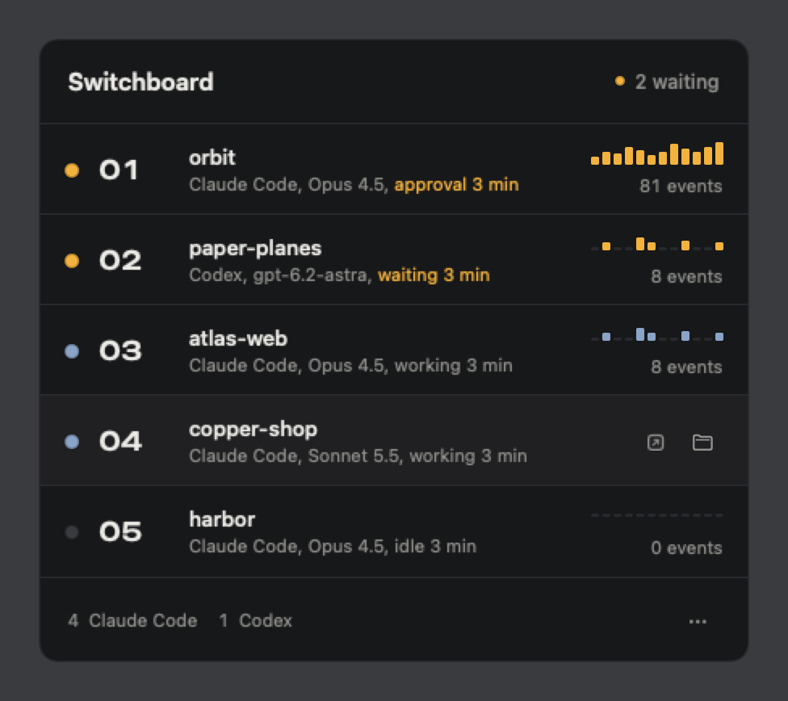

# Switchboard

See every running Claude Code and Codex CLI session, and which ones are waiting for you.

<p align="center"></p>

<p align="center">    </p>

Requires macOS 15 or later.

## What it does
- One line per session: a lamp, the project and one plain state, such as "Working, 3 min", "Waiting: needs permission" or "Finished". Hover a line for branch, worktree, tool, model, CLI version and recent activity.
- Amber lamp means waiting for you; grey is working; unlit is idle.
- A "Needs you" list at the top of the board holds what is waiting, oldest first, until you answer it. The header says "2 waiting" or "All working", and the menu bar icon shows the count.
- Click a session to jump to its exact tab in Terminal, iTerm, Ghostty or tmux, or to its VS Code or Cursor window. Other apps are just brought to the front. You can also reveal the folder.
- Optional alerts with a chime and quiet hours.

## Keyboard
| Action | Shortcut |
|---|---|
| Open the board | ⌥⌘B (changeable) |

## Install

**Homebrew**

```
brew tap noterikkirillov8/tap
brew trust noterikkirillov8/tap
brew install --cask switchboard
```

**Download**: get `Switchboard-1.0.0.zip` from [Releases](https://github.com/noterikkirillov8/switchboard/releases), unzip it and drag `Switchboard.app` to Applications.

**Build from source**: see below.

Switchboard isn't notarised by Apple (that needs a paid developer account), so the first time macOS may say it can't verify the developer: open System Settings → Privacy & Security, scroll down and click Open Anyway (on macOS 15 and later right-click → Open no longer works). The Homebrew cask clears that flag for you.

## How it works
Switchboard finds Claude Code and Codex CLI processes. For Claude Code it asks the local `claude agents --json --all` command for each session's status (with a 2-second limit), and it reads the last 64 KB of each session's local transcript (`~/.claude/projects`, `~/.codex/sessions`, or the folders named by `CLAUDE_CONFIG_DIR` and `CODEX_HOME`) for everything else. After 20 seconds a pending tool shows “Running a long step,” not a permission wait. A lamp that is waiting stays lit until it's answered. A completed reply ending in a question can still light the waiting lamp. Click **Turn on** in the board or enable **Accurate lamps** in Settings → Sources to add PermissionRequest and Stop hooks to both agents, plus Notification for Claude Code. Switchboard backs up existing `settings.json` (Claude Code) and `hooks.json` (Codex) in each agent’s `backups/` folder first. Turning the switch off removes only Switchboard’s hooks. **Not now** hides the offer for seven days without editing either file. The hooks use `/usr/bin/python3`. When Switchboard reads a hook log larger than 1 MiB, it keeps the last 2,000 lines. To update older hooks, turn accurate lamps off and on again. Jumping to a tab uses AppleScript for Terminal, iTerm and Ghostty, so macOS asks for Automation permission the first time; Switchboard explains it first. Notifications distinguish “Your turn” from “Needs permission” without storing the message text.

## Privacy
No network of its own, no telemetry. The local `claude` command is run with its non-essential traffic switched off. Transcript text is read only to detect state and is never kept or logged. Notifications are asked for only if you turn alerts on.

## Build from source
Needs Xcode 16+ and [XcodeGen](https://github.com/yonaskolb/XcodeGen).

```
scripts/test.sh                  # tests
NO_OPEN=1 scripts/install.sh      # build Release and install to /Applications
```
`scripts/install.sh` signs with the author's local certificate if you have it, and ad hoc otherwise, so it works on any Mac.

## Credits
MIT licence. Interface sounds by Kenney (kenney.nl), CC0.

---
Part of Patchbay: [Harbor](https://github.com/noterikkirillov8/harbor) / [Tally](https://github.com/noterikkirillov8/tally) / [Sweep](https://github.com/noterikkirillov8/sweep) / [Ledge](https://github.com/noterikkirillov8/ledge) / [Switchboard](https://github.com/noterikkirillov8/switchboard) / [Shutter](https://github.com/noterikkirillov8/shutter) / [Reel](https://github.com/noterikkirillov8/reel) / [Vigil](https://github.com/noterikkirillov8/vigil)
